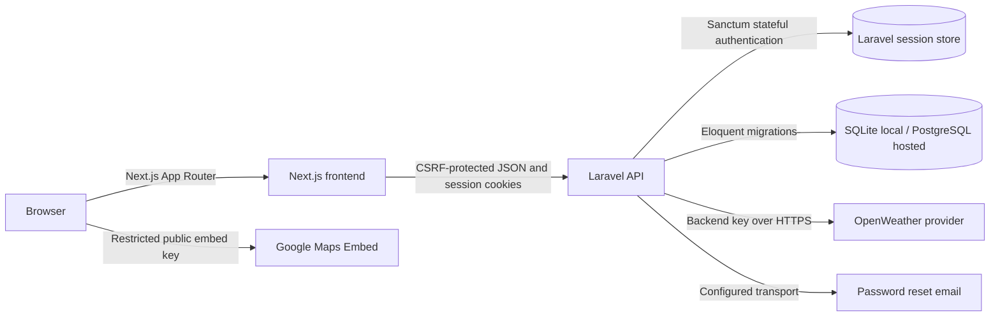

# Architecture

## Overview

The frontend is a Next.js application with App Router pages for login, registration, dashboard access, password reset, MFA login challenge, and account security settings. Its API helper requests Sanctum's CSRF cookie and sends session cookies with JSON requests.

The backend is a Laravel API that validates requests, stores users, handles registration and password recovery, and exposes protected dashboard, weather, and MFA endpoints. SQLite is the local database; PostgreSQL can be selected through environment configuration for a hosted deployment. Migrations and feature tests live in `backend/database/migrations` and `backend/tests`.

## Local flow

1. The browser loads a Next.js page and obtains a CSRF cookie from Laravel before a state-changing request.
2. The frontend sends JSON with the Laravel session cookie to the API on localhost:8000.
3. Laravel validates the request, then authenticates the user or returns a pending MFA challenge before granting a session.
4. Authenticated API requests use Sanctum session authentication; the backend reads and writes account data through Eloquent.
5. Weather is requested server-side only when `OPENWEATHER_API_KEY` is configured. Maps use a restricted, browser-visible embed key.
6. Password reset messages use the configured mail transport; local `MAIL_MAILER=log` records them locally instead of delivering email.

## Security controls

- Session-based authentication with Sanctum stateful domains
- CORS configuration for localhost frontend origins
- Server-side validation on every API route
- Password hashing via Laravel
- MFA support using TOTP-based verification
- Rate limits on account, password recovery, and MFA endpoints
- Password confirmation plus a current TOTP code required to disable MFA
- Previously accepted TOTP time-steps are rejected to prevent code replay
